<p align="center">
  
</p>

<h1 align="center">🫠 goome examples 🫠</h1>

<p align="center">
<b>Lots of small real programs made with goome, from tiny overlays to game mods.</b>
</p>

<p align="center">
  
  
  
  
  
  
  
</p>

<p align="center">
Every folder is one idea, small enough to read in a few minutes and copy into your own thing. CI builds all of them on every push and runs them on goome's test backend.<br> <br>
Do you like this project? If so, please let me know! <a href="https://sevvy-wevvy.com/discord">Discord</a>
</p>

<p align="center">
  <a href="https://goome-ui.github.io/docs/">Docs</a> &nbsp;·&nbsp;
  <a href="https://goome-ui.github.io/docs/builder/">Builder</a> &nbsp;·&nbsp;
  <a href="https://github.com/goome-ui/c-goome">C</a> &nbsp;·&nbsp;
  <a href="https://github.com/goome-ui/csharp-goome">C#</a> &nbsp;·&nbsp;
  <a href="https://github.com/goome-ui/python-goome">Python</a> &nbsp;·&nbsp;
  <a href="https://github.com/goome-ui/java-goome">Java</a> &nbsp;·&nbsp;
  <a href="https://github.com/goome-ui/godot-goome">Godot</a>
</p>

<p align="center">
  The apps in <a href="apps">apps/</a> are ready to download from the <a href="https://github.com/goome-ui/examples/releases/latest">latest release</a>. For a fresh project of your own theres <code>goome new</code> from <a href="https://github.com/goome-ui/goome-cli">goome-cli</a>.<br>
  Show what you made in <a href="https://github.com/goome-ui/c-goome/discussions">Discussions</a>, and the <a href="https://github.com/goome-ui/c-goome/labels/good%20first%20issue">good first issues</a> on c-goome are a good place to start helping.
</p>

<p align="center">
Don't want to write the layout by hand? Put it together in the <a href="https://goome-ui.github.io/docs/builder/">builder</a> and copy the code it gives you.
</p>

<details>
<summary align="center"><b>🫥 Overlay On Top Of Everything 🫥</b></summary>

<br>

<p align="center">
See-through, always on top, on every monitor. Only what you draw takes clicks, the rest goes to whatever is under it. This is what goome does if you dont ask for anything else. The snippet is a whole program you can build as is.
</p>

```c
#include "goome.h"

int main(void)
{
    goome *g = goome_open(NULL, NULL);
    goome_ui *u = goome_ui_new(g);
    double x = 40, y = 40, w = 260, h = 0;
    int open = 1, on = 0;
    while (open) {
        goome_event ev;
        while (goome_poll(g, &ev, 16) > 0) goome_ui_feed(u, &ev), open &= ev.type != GOOME_QUIT;
        if (!goome_ui_begin(u, 0)) continue;
        if (goome_ui_window(u, "on top of everything", &x, &y, &w, &h, GOOME_WIN_MOVE | GOOME_WIN_CLOSE, &open))
            goome_ui_toggle(u, "Clicks next to me go through", &on);
        goome_ui_window_end(u);
        goome_ui_end(u);
    }
    goome_close(g);
}
```

<p align="center">
More of these: <a href="c/hello_overlay">hello_overlay</a>, <a href="c/clock">clock</a>, <a href="c/crosshair">crosshair</a>, <a href="c/fps_hud">fps_hud</a>, <a href="c/stream_widget">stream_widget</a>
</p>

</details>

<details>
<summary align="center"><b>🪟 Make A Normal App 🪟</b></summary>

<br>

```c
#include "goome.h"

int main(void)
{
    goome *g = goome_open_app("My app", 640, 400, NULL);
    goome_ui *u = goome_ui_new(g);
    int running = 1, clicks = 0;
    while (running) {
        goome_event ev;
        while (goome_poll(g, &ev, 16) > 0) goome_ui_feed(u, &ev), running &= ev.type != GOOME_CLOSE && ev.type != GOOME_QUIT;
        if (!goome_ui_begin(u, 0)) continue;
        goome_ui_app(u, "My app", 0);
        if (goome_ui_button(u, "Click me")) clicks++;
        goome_ui_label(u, "clicked %d times", clicks);
        goome_ui_app_end(u);
        goome_ui_end(u);
    }
    goome_close(g);
}
```

<p align="center">
Thats a regular window with a title bar, like WinForms but on every desktop. <a href="c/notes">notes</a> and <a href="c/settings">settings</a> are bigger ones, and <a href="csharp/Contacts">Contacts</a> is the same idea in C#.
</p>

</details>

<details>
<summary align="center"><b>🎮 Inside A Game Engine 🎮</b></summary>

<br>

<p align="center">
No window and no threads here. goome draws into a pixel buffer and the engine uploads it as a texture. Input gets pushed in by hand. In C it looks like this:
</p>

```c
#include "goome.h"

int main(void)
{
    goome *g = goome_open(&(goome_opts){.mode = GOOME_MODE_OFFSCREEN, .width = 320, .height = 200}, NULL);
    goome_ui *u = goome_ui_new(g);
    goome_event click = {.type = GOOME_DOWN, .x = 60, .y = 60, .button = 1};
    goome_push(g, &click);
    for (int frame = 0; frame < 3; frame++) {
        goome_event ev;
        while (goome_poll(g, &ev, 0) > 0) goome_ui_feed(u, &ev);
        goome_ui_begin(u, 0);
        goome_ui_button(u, "Drawn into memory");
        goome_ui_end(u);
    }
    goome_image frame;
    goome_frame(g, &frame);
    goome_save_ppm("ui.ppm", frame.px, frame.w, frame.h, frame.stride);
    goome_close(g);
}
```

<p align="center">
<a href="c/offscreen_png">offscreen_png</a> does the same but writes a proper PNG. For real engines theres a folder each in <a href="engines">engines</a>, using the renderer and platform backends in <a href="vendor/backends">vendor/backends</a>. All of them ask <code>goome_ui_wants</code> each frame and keep the mouse and keys away from the game while goome is using them.
</p>

| folder | engine | how |
|---|---|---|
| [raylib](engines/raylib) | raylib 5.5 | offscreen goome + the `goome_gl3` renderer backend in raylib's GL context |
| [sdl_gl3](engines/sdl_gl3) | SDL2 + OpenGL 3 | the `goome_sdl2` platform backend + `goome_gl3` renderer backend |
| [love2d](engines/love2d) | LÖVE (Lua) | luajit ffi to a goome shared lib, frame copied into a love Image |

<p align="center">
For Unity theres a package in csharp-goome, see <a href="unity">the Unity sample</a>. Godot has its own addon in <a href="https://github.com/goome-ui/godot-goome">godot-goome</a> with a whole example project.
</p>

</details>

<details>
<summary align="center"><b>🔧 Game Mods 🔧</b></summary>

<br>

<p align="center">
goome drawn inside another program's frame, injected as a DLL, the way a Dear ImGui mod menu or ReShade gets in. Theres one per graphics api in <a href="mods/native">mods/native</a>: <a href="mods/native/dx11">dx11</a>, <a href="mods/native/dx12">dx12</a>, <a href="mods/native/opengl">opengl</a> and <a href="mods/native/vulkan">vulkan</a>. Each one builds to a <code>version.dll</code> you drop next to the game. It hooks the present call to draw the menu on top, and eats your input while it's up. Insert hides and shows it.
</p>

```sh
cd mods/native
bash build.sh dx11
```

<p align="center">
These are single player and modding only. They draw over the game and grab its input, which is exactly what anti-cheat bans for, so don't put one in an online game. Theres no injector and nothing that hides from anti-cheat. <a href="mods/native/testgame">mods/native/testgame</a> has a tiny game per api that CI loads each mod into, to check the menu draws and that a slider drag never reaches the game.<br> <br>
Unity games: <a href="https://github.com/goome-ui/csharp-goome/tree/main/mods">csharp-goome/mods</a> has plugin templates for BepInEx (5 and 6) and MelonLoader.<br>
Minecraft: <a href="https://github.com/goome-ui/java-goome">java-goome</a> has Fabric and NeoForge mods in its <code>minecraft</code> folder.
</p>

</details>

<details>
<summary align="center"><b>🎨 Change How It Looks 🎨</b></summary>

<br>

<p align="center">
Start simple. <a href="c/themes">themes</a> makes a whole theme from one color with <code>goome_ui_theme_make</code>, or grabs a preset with <code>goome_ui_theme_preset</code>, then <code>goome_ui_scale</code> makes everything bigger. The <a href="csharp/Themes">C#</a> and <a href="python/themes">Python</a> ones do the same.<br> <br>
Then change anything. <a href="c/skinned_menu">skinned_menu</a> swaps the window parts for nine slice skins and uses its own icons, and <a href="c/custom_knob">custom_knob</a> is a widget goome doesnt have, made with <code>goome_ui_custom</code>. It draws itself on a <code>goome_ui_canvas</code> and keeps its value in <code>goome_ui_store</code>.
</p>

</details>

<details>
<summary align="center"><b>🧩 C 🧩</b></summary>

<br>

<p align="center">
Each one is a single <code>main.c</code>. Build any of them with <code>cc -std=c99 -O2 -I../../vendor main.c ../../vendor/goome.c</code> from its folder, theres nothing to link. <code>vendor/goome.h</code> is goome 0.3.0.
</p>

| | Example | What it is |
|---|---|---|
| <a href="c/hello_overlay"></a> | [Hello Overlay](c/hello_overlay) | the smallest overlay: one window on top of everything, clicks next to it go through to whatever is underneath |
| <a href="c/hello_app">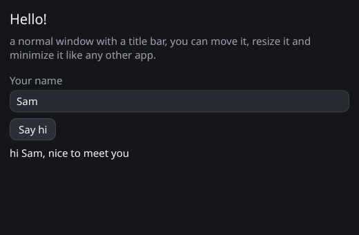</a> | [Hello App](c/hello_app) | start here for apps |
| <a href="c/offscreen_png">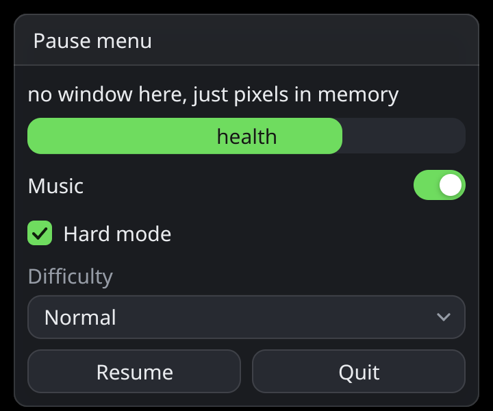</a> | [Offscreen PNG](c/offscreen_png) | ui drawn with no window and saved as a PNG, like inside an engine |
| <a href="c/clock">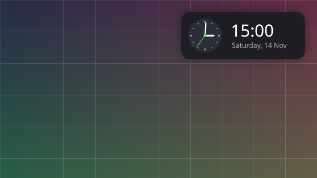</a> | [Clock](c/clock) | clock in the corner |
| <a href="c/fps_hud">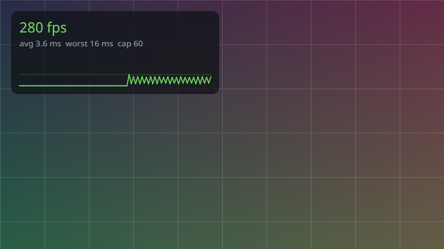</a> | [FPS HUD](c/fps_hud) | fps counter with a frame time graph |
| <a href="c/crosshair">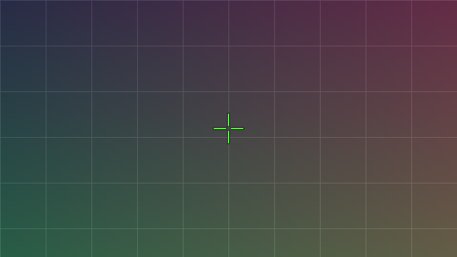</a> | [Crosshair](c/crosshair) | crosshair for games that dont have one |
| <a href="c/color_picker">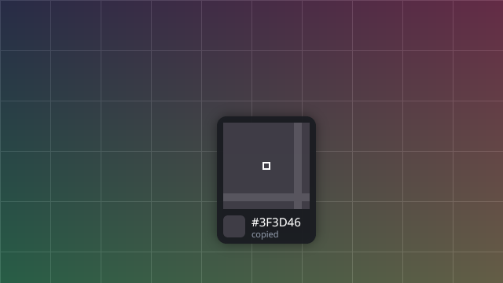</a> | [Color Picker](c/color_picker) | zoomed loupe under the mouse, copies the hex color |
| <a href="c/region_shot">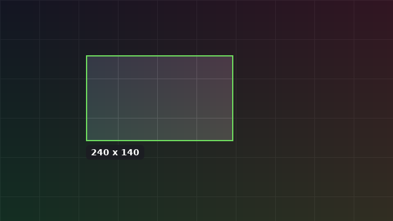</a> | [Region Shot](c/region_shot) | drag a box, save that part of the screen |
| <a href="c/launcher">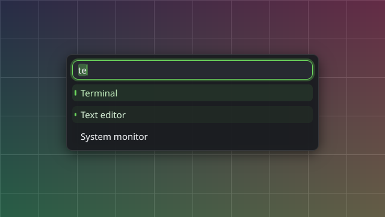</a> | [Launcher](c/launcher) | alt+space, type a few letters, enter. A tiny Spotlight that starts your apps |
| <a href="c/notes">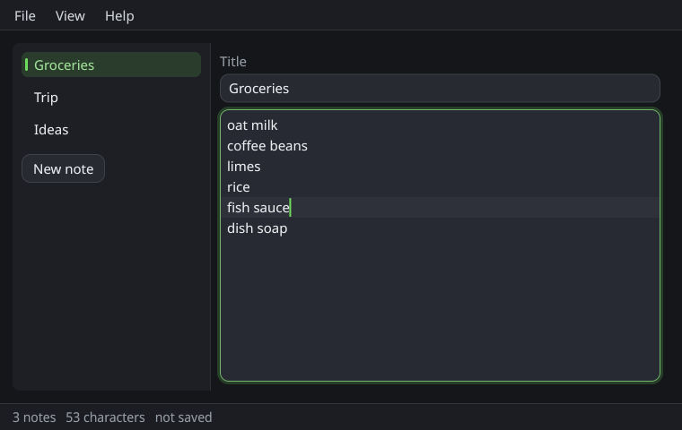</a> | [Notes](c/notes) | notes app with a menubar, sidebar and editor |
| <a href="c/settings">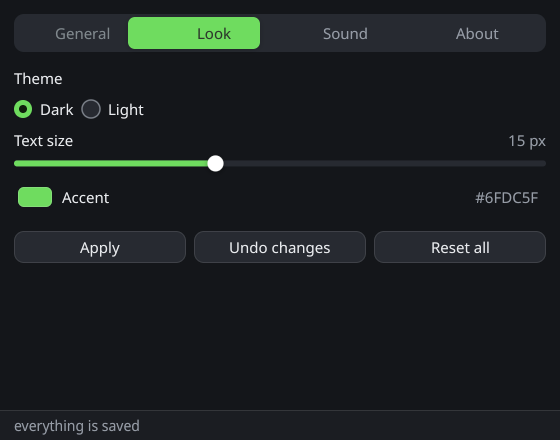</a> | [Settings](c/settings) | settings window with tabs and a live theme |
| <a href="c/image_viewer">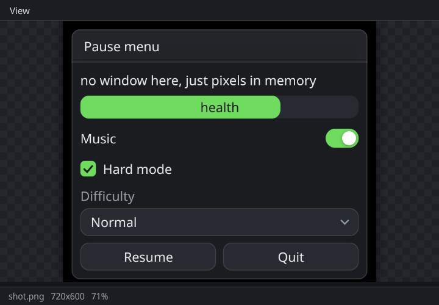</a> | [Image Viewer](c/image_viewer) | drop a picture on it, zoom and pan |
| <a href="c/todo"></a> | [Todo](c/todo) | todo list that saves to a text file |
| <a href="c/dashboard">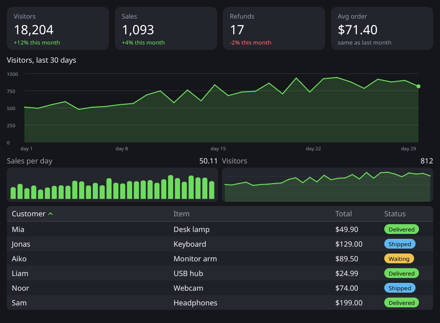</a> | [Dashboard](c/dashboard) | charts plus a sortable orders table |
| <a href="c/shaped_window">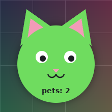</a> | [Shaped Window](c/shaped_window) | a window shaped like a cat |
| <a href="c/stream_widget">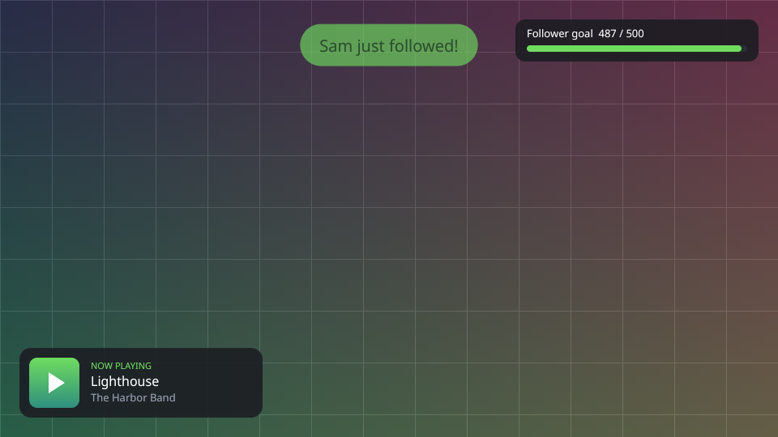</a> | [Stream Widget](c/stream_widget) | now playing, follower goal and alerts for streams |
| <a href="c/timer"></a> | [Timer](c/timer) | pomodoro timer that stays on top |
| <a href="c/csv_viewer">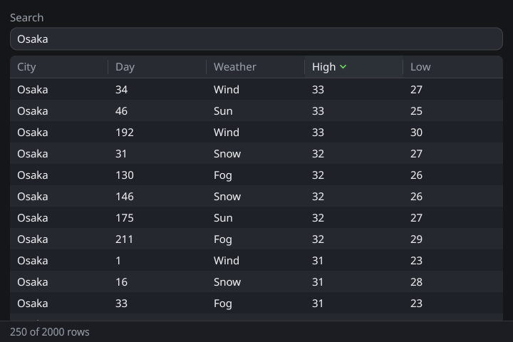</a> | [CSV Viewer](c/csv_viewer) | open a CSV and sort or search it. Only the visible rows get drawn, so 2000 rows is fine |
| <a href="c/themes">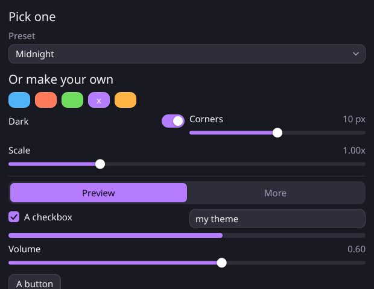</a> | [Themes](c/themes) | theme presets, a theme made from one color, and scaling the whole ui |
| <a href="c/skinned_menu">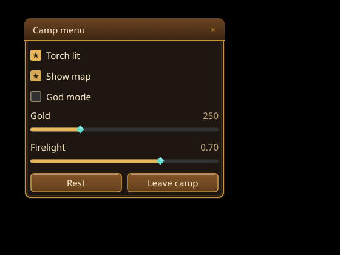</a> | [Skinned Menu](c/skinned_menu) | a game style menu with nine slice skins and its own icons |
| <a href="c/custom_knob">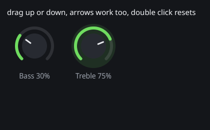</a> | [Custom Knob](c/custom_knob) | a knob widget made from scratch with goome_ui_custom |

</details>

<details>
<summary align="center"><b>💜 C# 💜</b></summary>

<br>

<p align="center">
Each one is a tiny .NET 8 project. They use the GoomeSharp project from a <a href="https://github.com/goome-ui/csharp-goome">csharp-goome</a> clone next to this repo, or the NuGet package with <code>-p:GoomeFromNuget=true</code>. <code>cd</code> into one and <code>dotnet run</code>.
</p>

| | Example | What it is |
|---|---|---|
| <a href="csharp/HelloOverlay"></a> | [Hello Overlay](csharp/HelloOverlay) | the smallest overlay in C# |
| <a href="csharp/HelloApp"></a> | [Hello App](csharp/HelloApp) | an app window in 15 lines |
| <a href="csharp/Offscreen">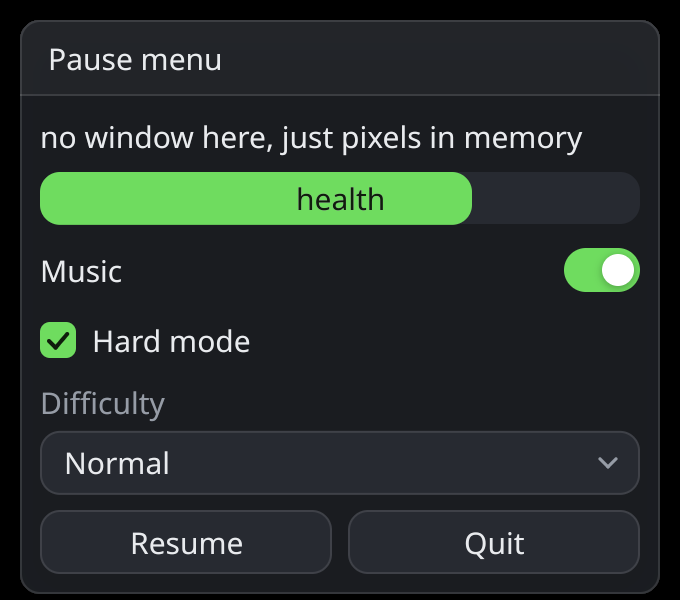</a> | [Offscreen](csharp/Offscreen) | ui drawn into memory and saved as a PNG |
| <a href="csharp/Clock">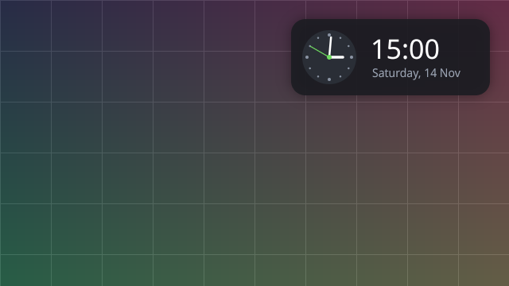</a> | [Clock](csharp/Clock) | clock card in the corner, drawn on the Canvas |
| <a href="csharp/ColorPicker"></a> | [Color Picker](csharp/ColorPicker) | loupe under the mouse, copies the hex color |
| <a href="csharp/Todo"></a> | [Todo](csharp/Todo) | todo list |
| <a href="csharp/Contacts">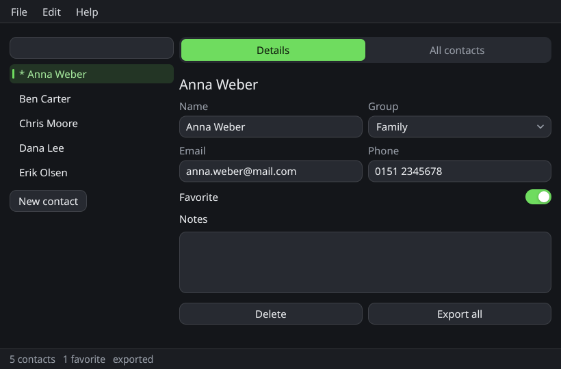</a> | [Contacts](csharp/Contacts) | a WinForms style address book with menus, a form, a grid and dialogs, the kind of app goome is made to replace WinForms for |
| <a href="csharp/Timer"></a> | [Timer](csharp/Timer) | pomodoro timer with a Canvas drawn ring |
| <a href="csharp/Themes">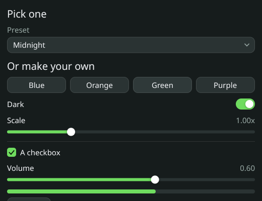</a> | [Themes](csharp/Themes) | presets, a theme from one color and scaling, in C# |

</details>

<details>
<summary align="center"><b>🐍 Python 🐍</b></summary>

<br>

<p align="center">
One script each. <code>pip install git+https://github.com/goome-ui/python-goome</code> once, then <code>python &lt;name&gt;.py</code>.
</p>

| | Example | What it is |
|---|---|---|
| <a href="python/hello_overlay">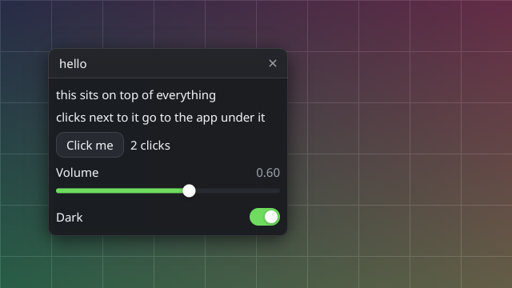</a> | [Hello Overlay](python/hello_overlay) | the smallest overlay in Python |
| <a href="python/hello_app"></a> | [Hello App](python/hello_app) | an app window with goome.App |
| <a href="python/offscreen_png"></a> | [Offscreen PNG](python/offscreen_png) | ui drawn into memory and saved as a PNG |
| <a href="python/clock"></a> | [Clock](python/clock) | clock card in the corner |
| <a href="python/color_picker"></a> | [Color Picker](python/color_picker) | loupe under the mouse, copies the hex color |
| <a href="python/crosshair">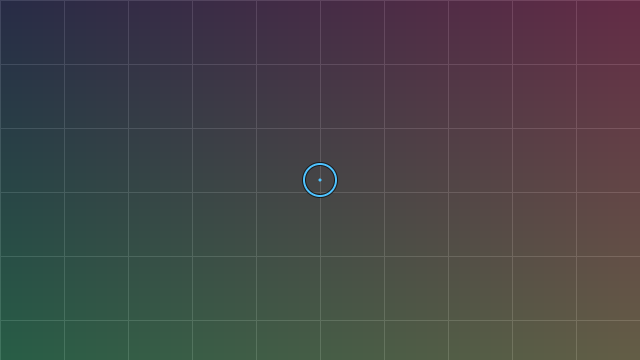</a> | [Crosshair](python/crosshair) | crosshair, three styles, resize with alt+up/down |
| <a href="python/todo">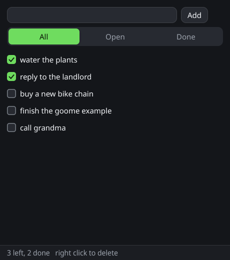</a> | [Todo](python/todo) | todo list on goome.App |
| <a href="python/timer">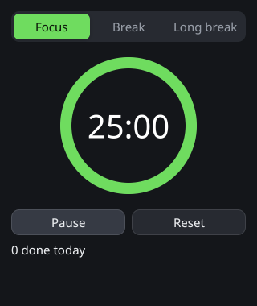</a> | [Timer](python/timer) | 25 minute focus timer |
| <a href="python/themes"></a> | [Themes](python/themes) | presets, a theme from one color and scaling, in Python |

</details>

<details>
<summary align="center"><b>🕹️ Unity 🕹️</b></summary>

<br>

| | Example | What it is |
|---|---|---|
| <a href="unity">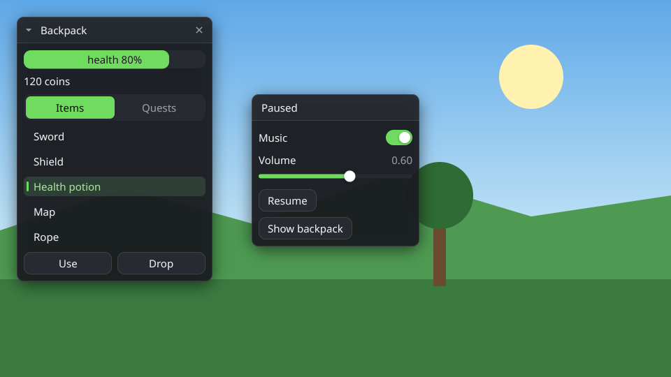</a> | [Unity Sample](unity) | a project skeleton with an in game backpack + pause menu and a desktop overlay, using the goome Unity package |

</details>

<details>
<summary align="center"><b>☕ Java And Godot ☕</b></summary>

<br>

<p align="center">
These live next to their bindings.<br> <br>
<a href="https://github.com/goome-ui/java-goome/tree/main/examples">java-goome/examples</a> has Hello, UiDemo, Notes, Offscreen, Custom, Skinned and a few more. Run one with <code>./gradlew :examples:runUiDemo</code>.<br>
<a href="https://github.com/goome-ui/godot-goome/tree/main/example">godot-goome/example</a> is a small Godot project with a goome window, and there are extra scenes in there for custom widgets and skins.
</p>

</details>

<details>
<summary align="center"><b>📜 Scripts 📜</b></summary>

<br>

| Script | What it does |
|---|---|
| [build-all.sh](scripts/build-all.sh) | builds every example (or just <code>c</code>, <code>csharp</code>, <code>python</code>, <code>unity</code>) |
| [run-all.sh](scripts/run-all.sh) | runs them all on goome's test backend and puts what they drew in <code>build/run/</code> |
| [build-all.ps1](scripts/build-all.ps1) | the same as build-all.sh for Windows PowerShell |
| [run-all.ps1](scripts/run-all.ps1) | the same as run-all.sh for Windows PowerShell |

<p align="center">
Clone <a href="https://github.com/goome-ui/csharp-goome">csharp-goome</a> next to this repo for the C# and Unity ones, and install python-goome for the Python ones. Missing ones get skipped with a note.
</p>

```sh
scripts/build-all.sh
scripts/run-all.sh
```

<p align="center">
<code>tools/update_goome.sh ../c-goome</code> copies a new <code>goome.h</code> into <code>vendor/</code>, and <code>tools/shots.py</code> remakes every <code>shot.png</code> from the last run.
</p>

<h3 align="center">📦 Other Versions</h3>

<p align="center">
<code>main</code> is always for the newest goome. For the examples that go with an older one, clone its tag:
</p>

```sh
git clone -b v0.4.0 https://github.com/goome-ui/examples
```

<p align="center">
The tags are on the <a href="https://github.com/goome-ui/examples/releases">releases page</a>.
</p>

</details>

<details>
<summary align="center"><b>🪟 Building On Windows 🪟</b></summary>

<br>

<p align="center">
The C examples build with MinGW the same way as anywhere else, just run the <code>.exe</code> after. With Visual Studio open a Developer Command Prompt in the example folder:
</p>

```bat
cl /O2 /I..\..\vendor main.c ..\..\vendor\goome.c
```

<p align="center">
No libraries to link either way, goome loads what it needs by itself. <code>scripts\build-all.ps1</code> builds all of them with whichever compiler it finds.
</p>

</details>

<details>
<summary align="center"><b>🛠 Pull Requests 🛠</b></summary>

<br>

<p align="center">
If youve got a small example that shows off something goome can do, make a pull request! <a href="CONTRIBUTING.md">CONTRIBUTING.md</a> has what an example needs. As long as it works and its one clear idea, its very likely it gets accepted.
</p>

</details>

<details>
<summary align="center"><b>⚖️ License ⚖️</b></summary>

<br>

<p align="center">
GPL-3.0, same as goome.<br>
<sub>
• You can use and change it, and share it<br>
• If you share a changed version, it has to stay GPL-3.0 and open<br>
• Keep the license and give credit
</sub><br> <br>
In short: play fair, keep it open, and give credit where it's due.
</p>

</details>

<details>
<summary align="center"><b>🩷 Donate 🩷</b></summary>

<br>

<p align="center">
<a href="https://sevvy-wevvy.com/kofi">Ko-fi</a> (Preferred)<br>
<a href="https://sevvy-wevvy.com/patreon">Patreon</a><br>
<a href="https://sevvy-wevvy.com/throne">Throne</a>
</p>

</details>

<p align="center">
<b>🫶 Contributors 🫶</b><br>
Thanks to everyone who helped out!<br> <br>
<a href="https://github.com/goome-ui/examples/graphs/contributors"></a>
</p>
