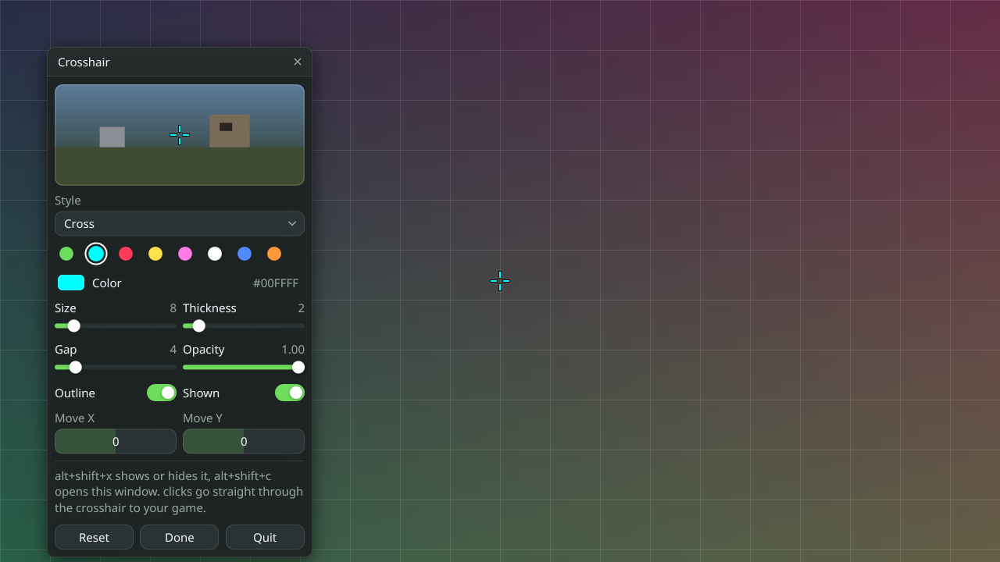

<h1 align="center">🎯 crosshair 🎯</h1>

<p align="center">

</p>

<p align="center">
A crosshair overlay for games that dont have one, or have a bad one. It sits in the middle of your screen and every click goes straight through it to the game. It doesnt touch the game at all, its just a see-through window on top, so anti cheat has nothing to look at.<br> <br>
Pick a style, a color, the size, thickness, gap and opacity in the settings window and see it live while you change it.
</p>

<details>
<summary align="center"><b>📦 Download 📦</b></summary>

<p align="center">
Grab <code>goome-crosshair-linux-x86_64.zip</code>, <code>goome-crosshair-windows-x86_64.zip</code> or <code>goome-crosshair-macos-universal.zip</code> from the <a href="https://github.com/goome-ui/examples/releases/latest">latest release</a>, unzip it and run <code>goome-crosshair</code>.<br> <br>
On a Mac the first launch gets blocked since its not signed. Right click it and pick Open, or run <code>xattr -d com.apple.quarantine goome-crosshair</code>.
</p>
</details>

<details>
<summary align="center"><b>⌨️ How To Use ⌨️</b></summary>

<p align="center">
<b>alt+shift+x</b> - shows or hides the crosshair<br>
<b>alt+shift+c</b> - opens the settings window<br> <br>
<b>Styles</b> - cross, cross with a dot, dot, circle, circle with a dot, T, chevron and square<br>
<b>Outline</b> - a thin dark edge so it shows up on bright and dark spots<br>
<b>Move X / Move Y</b> - drag them if your game's aim point isnt dead center<br>
<b>Monitor</b> - shows up when you have more than one screen<br> <br>
Settings save by themselves. The settings window opens on the first launch, after that it starts with just the crosshair.<br>
For it to show over a game, run the game in borderless or windowed mode. Real fullscreen on Windows skips everything on top of it.
</p>
</details>

<details>
<summary align="center"><b>🐧 Wayland 🐧</b></summary>

<p align="center">
Wayland doesnt let apps grab keys, so bind these in your compositor:
</p>

```sh
goome-crosshair --send toggle
goome-crosshair --send settings
goome-crosshair --send quit
```
</details>

<details>
<summary align="center"><b>🛠 Build It Yourself 🛠</b></summary>

```sh
cc -std=c99 -O2 -I../../vendor main.c ../../vendor/goome.c -o goome-crosshair
```
</details>
