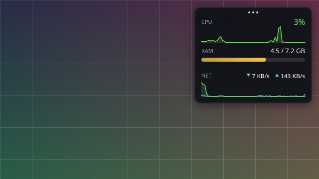

<h1 align="center">📊 goome-hud 📊</h1>

<p align="center">

</p>

<p align="center">
A little system monitor that sits in the corner of your screen, on top of everything, games too. CPU with a graph, RAM, network down and up with a graph, and temps on Linux.<br> <br>
Only the handle on top takes clicks. The rest of the panel lets clicks go straight through to whatever is under it, so you can leave it over a game or your editor and forget about it.
</p>

<details>
<summary align="center"><b>📦 Download 📦</b></summary>

<p align="center">
Grab <code>goome-hud-linux-x86_64.zip</code>, <code>goome-hud-windows-x86_64.zip</code> or <code>goome-hud-macos-universal.zip</code> from the <a href="https://github.com/goome-ui/examples/releases/latest">latest release</a>, unzip it and run <code>goome-hud</code>. No installer and nothing else to download.<br> <br>
On a Mac the first launch gets blocked since its not signed. Right click it and pick Open, or run <code>xattr -d com.apple.quarantine goome-hud</code>.
</p>
</details>

<details>
<summary align="center"><b>⌨️ How To Use ⌨️</b></summary>

<p align="center">
<b>drag the dots on top</b> - moves it, it snaps to the screen edges when you let go<br>
<b>right click the dots</b> - switches between the full panel and a one line bar<br>
<b>alt+shift+h</b> - hides it and shows it again<br>
<b>alt+shift+j</b> - full panel or one line bar<br> <br>
Where you left it gets saved, so it comes back in the same spot next time.<br>
Temps come from <code>/sys/class/hwmon</code> on Linux (CPU, plus AMD and Intel GPUs). Windows and macOS dont hand those out without admin tools, so that row just doesnt show up there.
</p>
</details>

<details>
<summary align="center"><b>🐧 Wayland 🐧</b></summary>

<p align="center">
Wayland doesnt let apps grab keys, so bind these in your compositor instead (Hyprland and Sway both work):
</p>

```sh
goome-hud --send hide
goome-hud --send size
goome-hud --send quit
```
</details>

<details>
<summary align="center"><b>🛠 Build It Yourself 🛠</b></summary>

```sh
cc -std=c99 -O2 -I../../vendor main.c ../../vendor/goome.c -o goome-hud
```

<p align="center">
Same line on Windows with mingw, and MSVC works too (<code>cl /O2 /I..\..\vendor main.c ..\..\vendor\goome.c</code>). No libraries to link.
</p>
</details>
