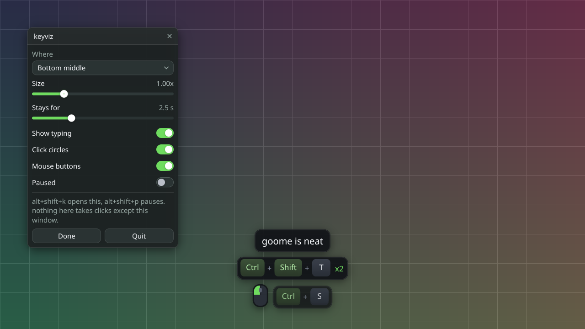

<h1 align="center">⌨️ keyviz ⌨️</h1>

<p align="center">

</p>

<p align="center">
Shows what you type and click, for tutorials, streams and screen recordings. Shortcuts show up as keycaps (<b>Ctrl + Shift + T</b>), pressing the same one again counts it up instead of stacking, normal typing shows as text, and clicks get a little ring where the mouse is.<br> <br>
None of it takes clicks, everything goes to the apps under it.
</p>

<details>
<summary align="center"><b>📦 Download 📦</b></summary>

<p align="center">
Grab <code>goome-keyviz-linux-x86_64.zip</code>, <code>goome-keyviz-windows-x86_64.zip</code> or <code>goome-keyviz-macos-universal.zip</code> from the <a href="https://github.com/goome-ui/examples/releases/latest">latest release</a>, unzip it and run <code>goome-keyviz</code>.<br> <br>
On a Mac the first launch gets blocked since its not signed. Right click it and pick Open, or run <code>xattr -d com.apple.quarantine goome-keyviz</code>. It also needs Input Monitoring (System Settings, Privacy & Security), it asks for it the first time.
</p>
</details>

<details>
<summary align="center"><b>⌨️ How To Use ⌨️</b></summary>

<p align="center">
<b>alt+shift+k</b> - settings<br>
<b>alt+shift+p</b> - pause, handy right before you type a password<br> <br>
<b>Where</b> - any corner, or the middle of the top or bottom<br>
<b>Size</b> and <b>Stays for</b> - how big and how long each line stays up<br>
<b>Show typing</b> - turn it off and only shortcuts and special keys show up<br>
<b>Click circles</b> and <b>Mouse buttons</b> - the rings and the little mouse next to the keys<br>
<b>Monitor</b> - shows up when you have more than one screen
</p>
</details>

<details>
<summary align="center"><b>🐧 Linux 🐧</b></summary>

<p align="center">
On X11 it just works. On Wayland apps cant see keys pressed in other apps, so keyviz reads them from <code>/dev/input</code> instead, and for that you need to be in the input group:
</p>

```sh
sudo usermod -aG input $USER
```

<p align="center">
Log out and back in after. That also gets you scroll on the mouse widget. Click rings need the mouse position, Wayland wont give that out, so on Wayland you get the mouse widget without the rings.<br> <br>
For the shortcuts on Wayland bind <code>goome-keyviz --send settings</code> and <code>goome-keyviz --send pause</code> in your compositor.
</p>
</details>

<details>
<summary align="center"><b>🛠 Build It Yourself 🛠</b></summary>

```sh
cc -std=c99 -O2 -I../../vendor main.c ../../vendor/goome.c -o goome-keyviz
```

<p align="center">
On Windows it reads keys with <code>GetAsyncKeyState</code>, so no hooks and nothing injected. On macOS its <code>CGEventSourceKeyState</code>, loaded at runtime so theres still nothing to link.
</p>
</details>
