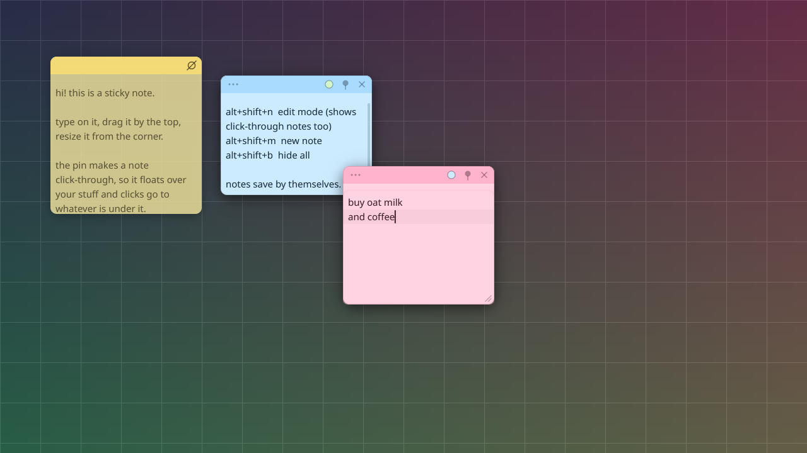

<h1 align="center">🗒️ sticky 🗒️</h1>

<p align="center">

</p>

<p align="center">
Sticky notes that float over everything. Write a shopping list or a build order and keep it on screen while you do the thing.<br> <br>
Every note can be pinned or click-through. Pinned ones you can type in and move around. Click-through ones fade a bit and every click goes through them to whatever is under, so they work as a cheat sheet on top of a game or a video. Notes save to a file by themselves.
</p>

<details>
<summary align="center"><b>📦 Download 📦</b></summary>

<p align="center">
Grab <code>goome-sticky-linux-x86_64.zip</code>, <code>goome-sticky-windows-x86_64.zip</code> or <code>goome-sticky-macos-universal.zip</code> from the <a href="https://github.com/goome-ui/examples/releases/latest">latest release</a>, unzip it and run <code>goome-sticky</code>.<br> <br>
On a Mac the first launch gets blocked since its not signed. Right click it and pick Open, or run <code>xattr -d com.apple.quarantine goome-sticky</code>.
</p>
</details>

<details>
<summary align="center"><b>⌨️ How To Use ⌨️</b></summary>

<p align="center">
<b>drag the top of a note</b> - moves it<br>
<b>drag the corner</b> - resizes it<br>
<b>the pin</b> - makes the note click-through, click it again in edit mode to pin it back<br>
<b>the circle</b> - next color (yellow, pink, blue, green, purple and dark)<br>
<b>the x</b> - throws the note away<br> <br>
<b>alt+shift+n</b> - edit mode, shows the click-through notes as normal ones plus a bar with New note, Hide all and Quit<br>
<b>alt+shift+m</b> - new note<br>
<b>alt+shift+b</b> - hides every note and shows them again
</p>
</details>

<details>
<summary align="center"><b>💾 Where The Notes Go 💾</b></summary>

<p align="center">
Linux: <code>~/.config/goome-sticky/notes.txt</code><br>
Windows: <code>%APPDATA%\goome-sticky\notes.txt</code><br>
macOS: <code>~/Library/Application Support/goome-sticky/notes.txt</code><br> <br>
Its plain text, one note is a <code>note x y w h color clickthrough</code> line and a <code>text</code> line. It gets written to a temp file and swapped in, so a crash cant eat your notes.
</p>
</details>

<details>
<summary align="center"><b>🐧 Wayland 🐧</b></summary>

<p align="center">
Wayland doesnt let apps grab keys, so bind these in your compositor:
</p>

```sh
goome-sticky --send edit
goome-sticky --send new
goome-sticky --send hide
```
</details>

<details>
<summary align="center"><b>🛠 Build It Yourself 🛠</b></summary>

```sh
cc -std=c99 -O2 -I../../vendor main.c ../../vendor/goome.c -o goome-sticky
```
</details>
