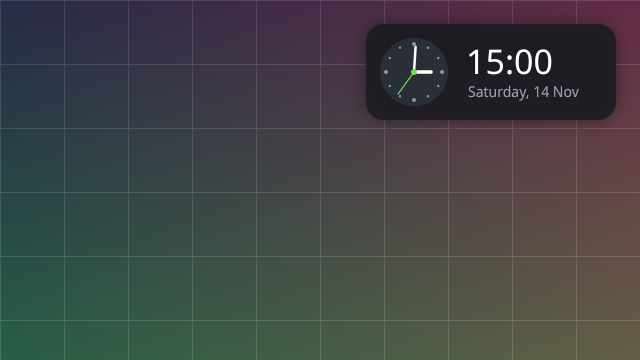

<h1 align="center">🕐 Clock 🕐</h1>

A clock card in the top right corner of every screen. Analog hands plus the time and date, and it never takes a single click. <b>alt+c</b> hides it and shows it again.

