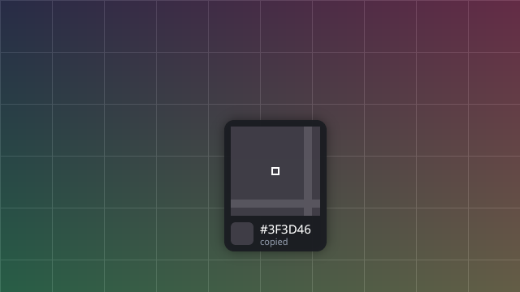

<h1 align="center">🎨 Color Picker 🎨</h1>

<p align="center">

</p>

<p align="center">
Follows your mouse with a zoomed in loupe of the screen under it and shows the hex color of the middle pixel. Uses goome's screen grabs and the clipboard.<br> <br>
<b>move the mouse</b> - the loupe follows it<br>
<b>alt+p</b> - copies the hex color
</p>

```sh
cc -std=c99 -O2 -I../../vendor main.c ../../vendor/goome.c -o color_picker
```
