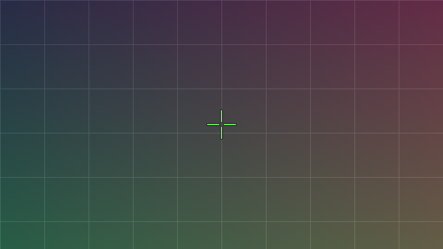

<h1 align="center">🎯 Crosshair 🎯</h1>

A crosshair in the middle of the screen, for games that dont have one. Clicks go straight through it to the game. <b>alt+x</b> next style (cross, dot, circle) and color. <b>alt+up / alt+down</b> bigger and smaller. <b>alt+h</b> hides it.

