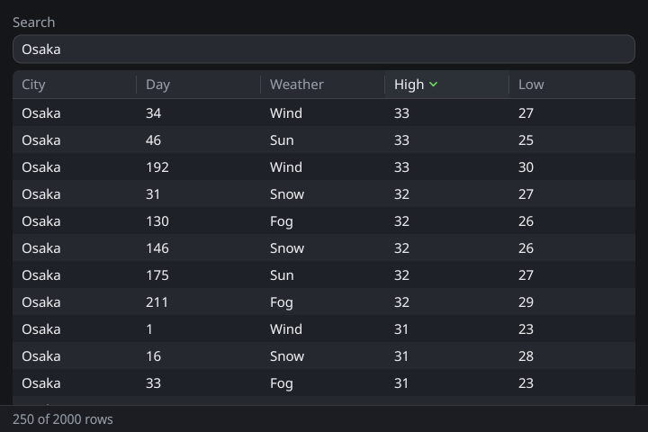

<h1 align="center">📋 CSV Viewer 📋</h1>

<p align="center">

</p>

<p align="center">
Opens a CSV file in a sortable table with a search box. Only the rows you can see get drawn, so a few thousand rows is nothing. Without a file it makes up 2000 rows of weather.
</p>

<details>
<summary align="center"><b>⌨️ How To Use ⌨️</b></summary>

<p align="center">
<b>./csv_viewer file.csv</b> - opens your own<br>
<b>click a column</b> - sorts by it
</p>
</details>

<details>
<summary align="center"><b>🛠 Build And Run 🛠</b></summary>

```sh
cc -std=c99 -O2 -I../../vendor main.c ../../vendor/goome.c -o csv_viewer
./csv_viewer
```
</details>
