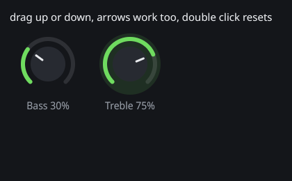

<h1 align="center">🎛 Custom Knob 🎛</h1>

<p align="center">

</p>

<p align="center">
A widget goome doesn't have, made with <code>goome_ui_custom</code>. It hands back hover, drag and key info for a box, <code>goome_ui_canvas</code> draws into it, and <code>goome_ui_store</code> keeps the values between frames so there's no state of your own. Drag up or down, arrows work when it's focused, double click resets.
</p>

```sh
cc -std=c99 -O2 -I../../vendor main.c ../../vendor/goome.c -o custom_knob
```
