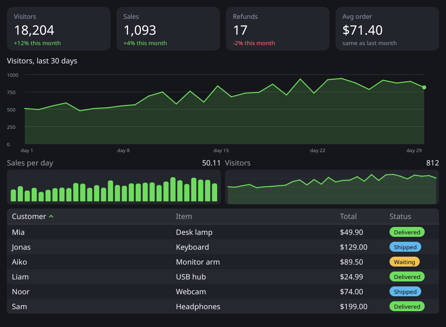

<h1 align="center">📊 Dashboard 📊</h1>

<p align="center">

</p>

<p align="center">
A stats dashboard. The cards and the big chart are drawn with goome's drawing layer into a bitmap that sits in the ui like any picture, the small charts and the orders table are ui widgets.<br> <br>
<b>click a column</b> - sorts the table
</p>

```sh
cc -std=c99 -O2 -I../../vendor main.c ../../vendor/goome.c -o dashboard
```
