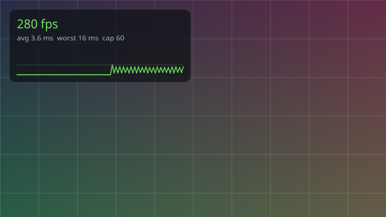

<h1 align="center">📈 FPS HUD 📈</h1>

<p align="center">

</p>

<p align="center">
An fps counter like the ones games have, with a frame time graph. It measures its own loop, so its handy to see how fast goome can draw on your machine.<br> <br>
<b>alt+f</b> - switches between the small and the big one<br>
<b>click it</b> - changes the fps cap between 60, 144 and 30
</p>

```sh
cc -std=c99 -O2 -I../../vendor main.c ../../vendor/goome.c -o fps_hud
```
