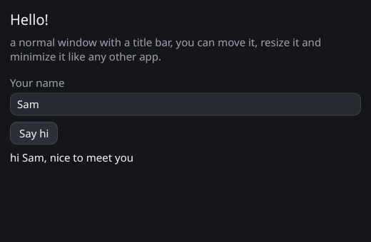

<h1 align="center">🪟 Hello App 🪟</h1>

<p align="center">

</p>

<p align="center">
A normal app window, the kind you would make with WinForms. Title bar, resize, minimize, all of it. One call, <code>goome_open_app</code>, and the ui kit fills the window.<br>
If you want a regular program, start from this one.
</p>

```sh
cc -std=c99 -O2 -I../../vendor main.c ../../vendor/goome.c -o hello_app
```
