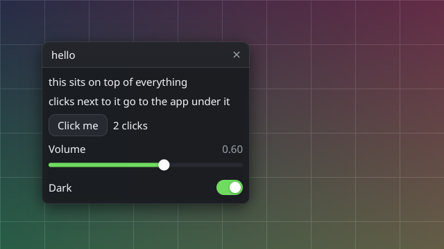

<h1 align="center">👋 Hello Overlay 👋</h1>

<p align="center">

</p>

<p align="center">
The smallest overlay there is. A little window that sits on top of everything, and every click that misses it lands on whatever is under it, like it isnt even there.<br>
This is the one to copy if you want something on top of your screen.<br> <br>
<b>drag the title</b> - moves it<br>
<b>the x</b> - closes it and quits
</p>

```sh
cc -std=c99 -O2 -I../../vendor main.c ../../vendor/goome.c -o hello_overlay
```
