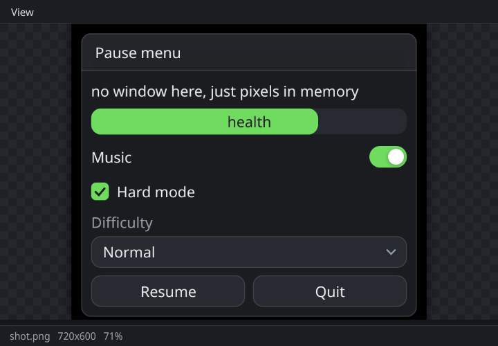

<h1 align="center">🖼️ Image Viewer 🖼️</h1>

<p align="center">

</p>

<p align="center">
Opens PNG, JPEG, BMP, PPM and QOI, all decoded by goome itself. Drop a file on the window or pass it on the command line.
</p>

<details>
<summary align="center"><b>⌨️ How To Use ⌨️</b></summary>

<p align="center">
<b>drop a file</b> - opens it<br>
<b>scroll</b> - zoom<br>
<b>drag</b> - move it around<br>
<b>View menu</b> - fit to window or real size
</p>
</details>

<details>
<summary align="center"><b>🛠 Build And Run 🛠</b></summary>

```sh
cc -std=c99 -O2 -I../../vendor main.c ../../vendor/goome.c -o image_viewer
./image_viewer
```
</details>
