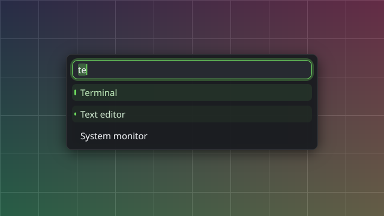

<h1 align="center">🚀 Launcher 🚀</h1>

<p align="center">

</p>

<p align="center">
A small Spotlight / Alfred style launcher. Press the hotkey, type a few letters, hit enter. The list of apps is at the top of <code>main.c</code>, one per OS, change it to whatever you use.
</p>

<details>
<summary align="center"><b>⌨️ How To Use ⌨️</b></summary>

<p align="center">
<b>alt+space</b> - open and close it<br>
<b>type</b> - filter, the letters just have to show up in order<br>
<b>up / down</b> - pick one<br>
<b>enter</b> - start it<br>
<b>esc</b> - close it
</p>
</details>

<details>
<summary align="center"><b>🛠 Build And Run 🛠</b></summary>

```sh
cc -std=c99 -O2 -I../../vendor main.c ../../vendor/goome.c -o launcher
./launcher
```
</details>
