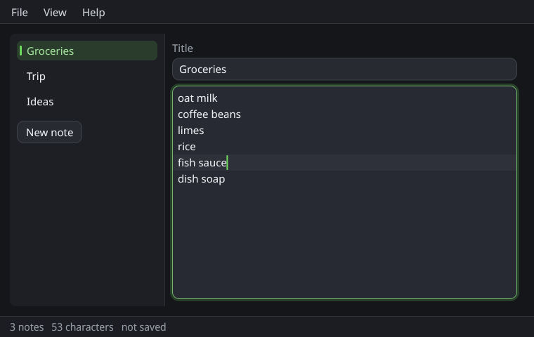

<h1 align="center">📝 Notes 📝</h1>

<p align="center">

</p>

<p align="center">
A notes app with a menubar, a sidebar you can drag bigger, a multiline editor with wrapping and line numbers, and a statusbar. Saves everything to <code>notes.md</code>.
</p>

<details>
<summary align="center"><b>⌨️ How To Use ⌨️</b></summary>

<p align="center">
<b>ctrl+n</b> - new note<br>
<b>ctrl+s</b> - save<br>
<b>drag the bar</b> - resizes the sidebar
</p>
</details>

<details>
<summary align="center"><b>🛠 Build And Run 🛠</b></summary>

```sh
cc -std=c99 -O2 -I../../vendor main.c ../../vendor/goome.c -o notes
./notes
```
</details>
