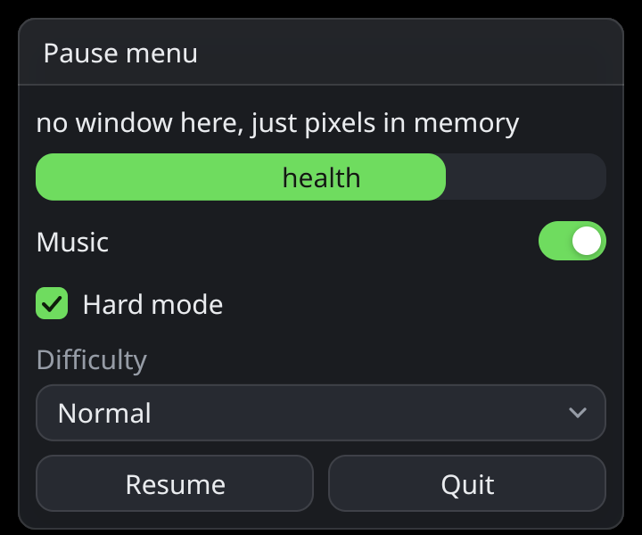

<h1 align="center">🎮 Offscreen PNG 🎮</h1>

<p align="center">

</p>

<p align="center">
No window at all. goome draws the ui into memory, a click gets pushed in by hand, and the finished frame gets saved as <code>offscreen.png</code> with real see-through alpha.<br>
Thats exactly how goome sits inside a game engine: the engine feeds it input and uploads the pixels as a texture. The PNG writer is in there too, about 60 lines with no zlib.<br> <br>
<b>./offscreen_png out.png</b> - saves somewhere else
</p>

```sh
cc -std=c99 -O2 -I../../vendor main.c ../../vendor/goome.c -o offscreen_png
```
