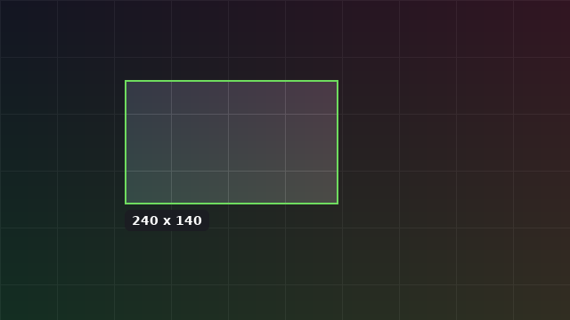

<h1 align="center">✂️ Region Shot ✂️</h1>

<p align="center">

</p>

<p align="center">
Snipping tool style screenshots. Press the hotkey, drag a box, and that part of the screen gets saved as <code>shot-1.ppm</code>, <code>shot-2.ppm</code> and so on.
</p>

<details>
<summary align="center"><b>⌨️ How To Use ⌨️</b></summary>

<p align="center">
<b>alt+s</b> - start picking<br>
<b>drag</b> - pick the box<br>
<b>esc</b> - stop
</p>
</details>

<details>
<summary align="center"><b>🛠 Build And Run 🛠</b></summary>

```sh
cc -std=c99 -O2 -I../../vendor main.c ../../vendor/goome.c -o region_shot
./region_shot
```
</details>
