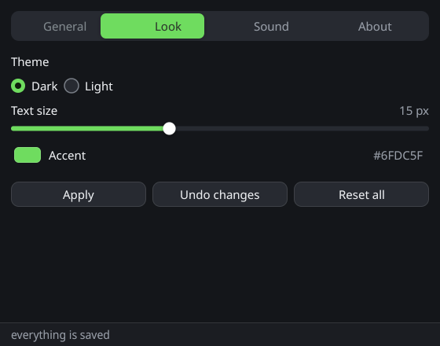

<h1 align="center">⚙️ Settings ⚙️</h1>

<p align="center">

</p>

<p align="center">
The settings window every app has. Tabs, toggles, a language dropdown, a color picker, a theme switch that changes the whole ui live, and a reset that asks first. Apply writes <code>settings.ini</code>.
</p>

```sh
cc -std=c99 -O2 -I../../vendor main.c ../../vendor/goome.c -o settings
```
