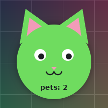

<h1 align="center">🐱 Shaped Window 🐱</h1>

A borderless window with real see-through pixels, so its shaped like a cat and not like a box. No title bar, so it moves itself with <code>goome_window_drag</code>. <b>drag it</b> moves it. <b>click the nose</b> pet it. <b>right click or esc</b> quit.

