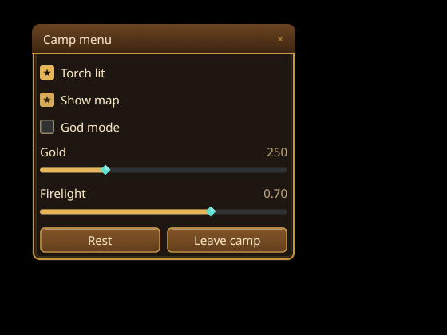

<h1 align="center">🪵 Skinned Menu 🪵</h1>

<p align="center">

</p>

<p align="center">
A game style camp menu where the buttons, the window and its title bar are nine slice skins, and the checkmark, close button and slider knob are swapped for a star, a cross and a gem. The pictures get drawn with the drawing layer at startup so there are no files to ship, but any png from <code>goome_bitmap_load</code> works the same way.
</p>

```sh
cc -std=c99 -O2 -I../../vendor main.c ../../vendor/goome.c -o skinned_menu
```
