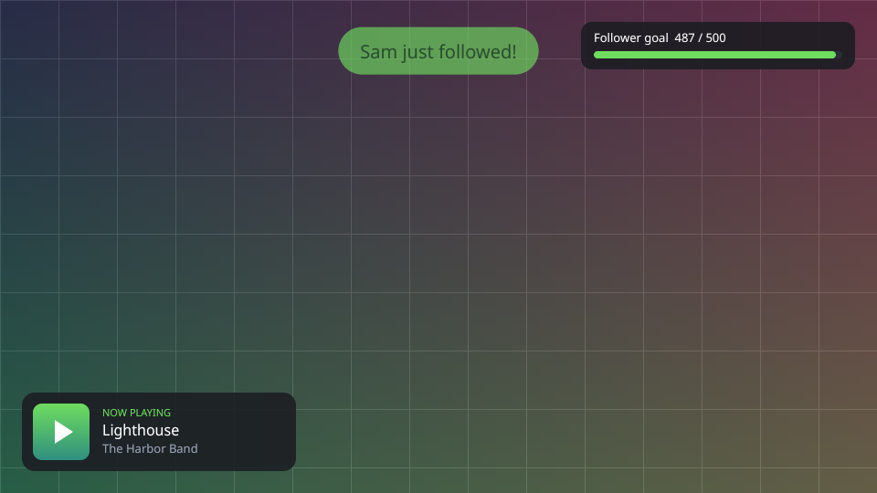

<h1 align="center">📺 Stream Widget 📺</h1>

<p align="center">

</p>

<p align="center">
Stuff for streaming: a now playing card, a follower goal bar and alerts that slide in. Anything can drive it by adding lines to <code>stream.txt</code>, so a bot or a script works fine, and <code>goome_send</code> works too.
</p>

<details>
<summary align="center"><b>⌨️ How To Use ⌨️</b></summary>

<p align="center">
<b>follow Sam</b> - alert + goal goes up<br>
<b>sub Sam</b> - sub alert<br>
<b>song Title - Artist</b> - changes the now playing card
</p>
</details>

<details>
<summary align="center"><b>🛠 Build And Run 🛠</b></summary>

```sh
cc -std=c99 -O2 -I../../vendor main.c ../../vendor/goome.c -o stream_widget
./stream_widget
```
</details>
