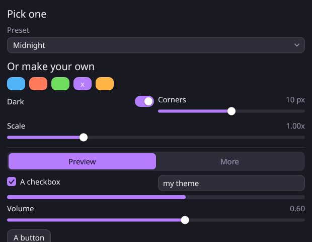

<h1 align="center">🎨 Themes 🎨</h1>

<p align="center">

</p>

<p align="center">
Pick a preset or make a theme from one accent color, and scale the whole ui. It's three calls:
</p>

```c
goome_ui_theme_preset(goome_ui_theme(u), GOOME_PRESET_MIDNIGHT);
goome_ui_theme_make(goome_ui_theme(u), 0xFF6FDC5F, 1, 10);
goome_ui_scale(u, 1.25);
```

<p align="center">
<code>theme_make</code> works out the rest of the colors from the accent, and <code>scale</code> grows every size in the theme, not just the font.
</p>

```sh
cc -std=c99 -O2 -I../../vendor main.c ../../vendor/goome.c -o themes
```
