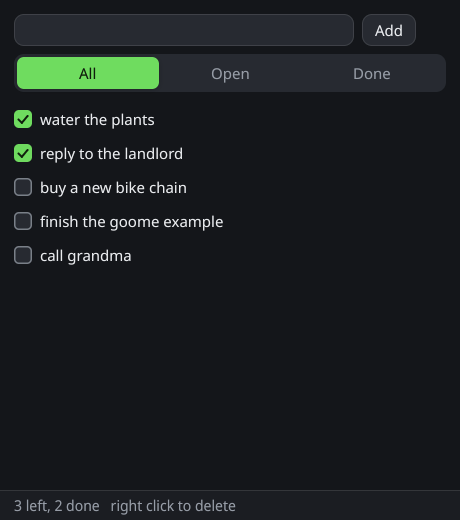

<h1 align="center">✅ Todo ✅</h1>

<p align="center">

</p>

<p align="center">
A todo list that saves to <code>todo.txt</code>. Small, but it has everything a real one needs: add, tick off, filter, right click menu.<br> <br>
<b>enter</b> - adds what you typed<br>
<b>right click</b> - delete or move to top
</p>

```sh
cc -std=c99 -O2 -I../../vendor main.c ../../vendor/goome.c -o todo
```
