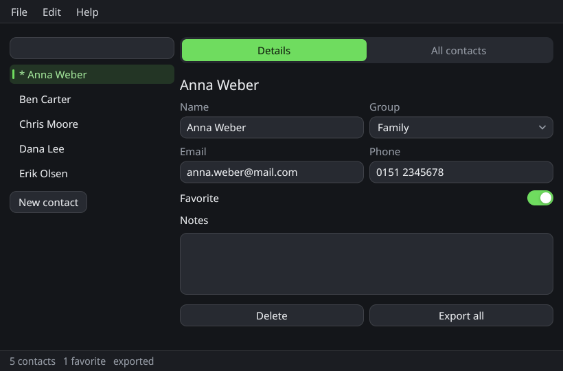

<h1 align="center">📇 Contacts 📇</h1>

<p align="center">

</p>

<p align="center">
The WinForms replacement one. An address book with a menubar, a list, a form with text boxes and a dropdown, a sortable grid, dialogs, toasts and a statusbar. Thats most of what a WinForms app is, without the designer and without being stuck on Windows.
</p>

<details>
<summary align="center"><b>⌨️ How To Use ⌨️</b></summary>

<p align="center">
<b>ctrl+n</b> - new contact<br>
<b>ctrl+s</b> - export to contacts.csv<br>
<b>All contacts tab</b> - the grid, click a column to sort
</p>
</details>

<details>
<summary align="center"><b>🛠 Build And Run 🛠</b></summary>

```sh
dotnet run
```

<p align="center">
It finds GoomeSharp in a <a href="https://github.com/goome-ui/csharp-goome">csharp-goome</a> clone next to this repo. No clone? <code>dotnet run -p:GoomeFromNuget=true</code> grabs the NuGet package instead.
</p>
</details>
