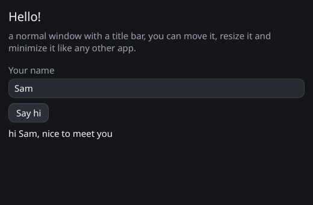

<h1 align="center">🪟 Hello App 🪟</h1>

<p align="center">

</p>

<p align="center">
A normal app window in about 15 lines. <code>GoomeApp.Run</code> opens the window, runs the loop and fills the window with the ui, you just say whats in it.
</p>

<details>
<summary align="center"><b>🛠 Build And Run 🛠</b></summary>

```sh
dotnet run
```

<p align="center">
It finds GoomeSharp in a <a href="https://github.com/goome-ui/csharp-goome">csharp-goome</a> clone next to this repo. No clone? <code>dotnet run -p:GoomeFromNuget=true</code> grabs the NuGet package instead.
</p>
</details>
