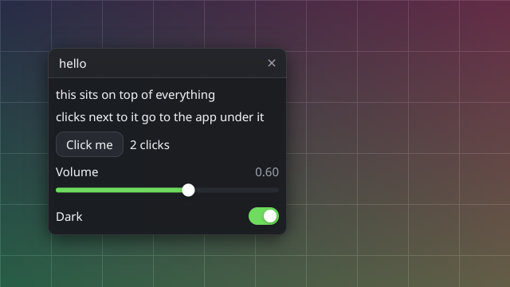

<h1 align="center">👋 Hello Overlay 👋</h1>

<p align="center">

</p>

<p align="center">
The smallest overlay in C#. A little window on top of everything, and every click that misses it goes to whatever is under it.
</p>

<details>
<summary align="center"><b>⌨️ How To Use ⌨️</b></summary>

<p align="center">
<b>the x</b> - quits
</p>
</details>

<details>
<summary align="center"><b>🛠 Build And Run 🛠</b></summary>

```sh
dotnet run
```

<p align="center">
It finds GoomeSharp in a <a href="https://github.com/goome-ui/csharp-goome">csharp-goome</a> clone next to this repo. No clone? <code>dotnet run -p:GoomeFromNuget=true</code> grabs the NuGet package instead.
</p>
</details>
