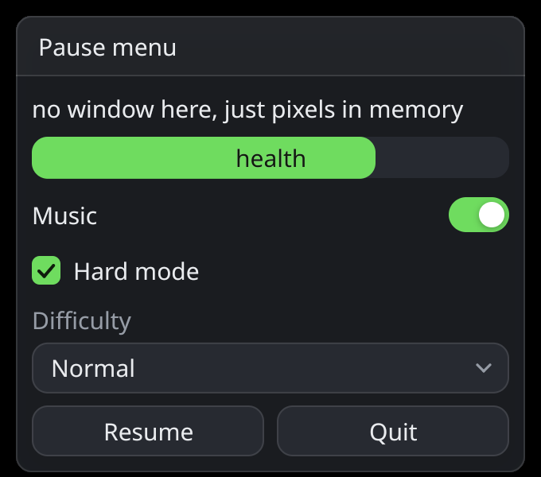

<h1 align="center">🎮 Offscreen 🎮</h1>

<p align="center">

</p>

<p align="center">
No window, goome draws into memory, a click gets pushed in and the frame gets saved as <code>offscreen.png</code> with real alpha. Same thing the Unity package does every frame.
</p>

<details>
<summary align="center"><b>🛠 Build And Run 🛠</b></summary>

```sh
dotnet run
```

<p align="center">
It finds GoomeSharp in a <a href="https://github.com/goome-ui/csharp-goome">csharp-goome</a> clone next to this repo. No clone? <code>dotnet run -p:GoomeFromNuget=true</code> grabs the NuGet package instead.
</p>
</details>
