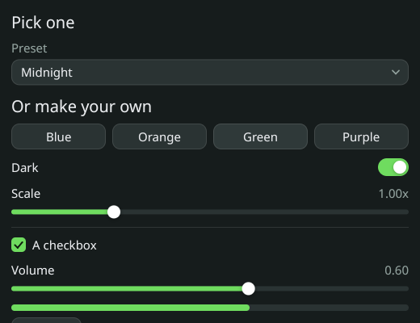

<h1 align="center">🎨 Themes 🎨</h1>

<p align="center">

</p>

<p align="center">
Theme presets, a theme made from one accent color, and scaling the whole ui, with <code>ui.Theme.Preset</code>, <code>ui.Theme.Make</code> and <code>ui.Scale</code>.
</p>

<details>
<summary align="center"><b>🛠 Build And Run 🛠</b></summary>

```sh
dotnet run
```

<p align="center">
It finds GoomeSharp in a <a href="https://github.com/goome-ui/csharp-goome">csharp-goome</a> clone next to this repo. No clone? <code>dotnet run -p:GoomeFromNuget=true</code> grabs the NuGet package instead.
</p>
</details>
