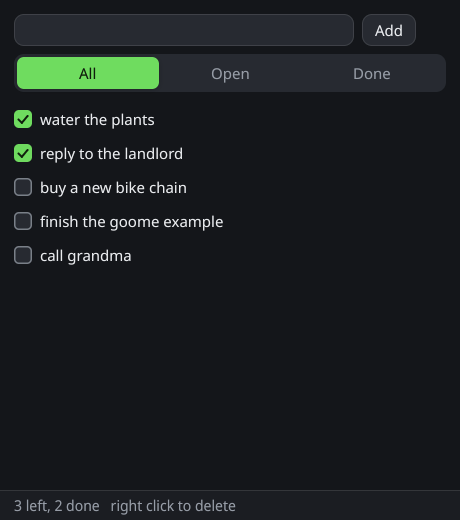

<h1 align="center">✅ Todo ✅</h1>

<p align="center">

</p>

<p align="center">
A todo list on <code>GoomeApp</code> that saves to <code>todo.txt</code>.
</p>

<details>
<summary align="center"><b>⌨️ How To Use ⌨️</b></summary>

<p align="center">
<b>enter</b> - adds it<br>
<b>right click</b> - delete or move to top
</p>
</details>

<details>
<summary align="center"><b>🛠 Build And Run 🛠</b></summary>

```sh
dotnet run
```

<p align="center">
It finds GoomeSharp in a <a href="https://github.com/goome-ui/csharp-goome">csharp-goome</a> clone next to this repo. No clone? <code>dotnet run -p:GoomeFromNuget=true</code> grabs the NuGet package instead.
</p>
</details>
