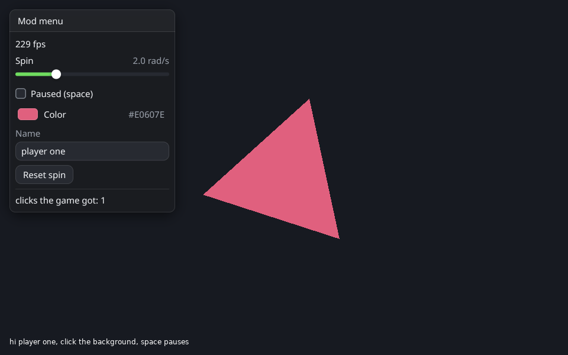

<h1 align="center">💜 LÖVE 💜</h1>

<p align="center">

</p>

<p align="center">
goome inside a LÖVE game with no C glue at all. <code>main.lua</code> loads goome as a shared library through LuaJIT's ffi, runs it offscreen, copies only the changed part of each frame into an <code>ImageData</code> and draws it on top with premultiplied alpha.<br>
LÖVE's mouse and keys get pushed into goome. A click on the menu doesn't count as a game click, and space wont pause while you type in the name box.<br> <br>
<b>Click</b> - counted by the game, <b>space</b> - pause, <b>esc</b> - quit
</p>

```sh
sudo apt install love
cc -O2 -shared -fPIC -I../../vendor ../../vendor/goome.c -lm -lpthread -ldl -o libgoome.so
love .
```

<p align="center">
The library has to sit next to <code>main.lua</code>: <code>libgoome.so</code> on Linux, <code>libgoome.dylib</code> on macOS, <code>goome.dll</code> on Windows (<code>cc -O2 -shared ../../vendor/goome.c -o goome.dll</code> with MinGW). Run it from the folder with <code>love .</code>, a zipped <code>.love</code> file can't load a library from inside itself.<br> <br>
The ffi declarations copy goome's structs by hand, so if you update <code>vendor/goome.h</code> and <code>goome_opts</code>, <code>goome_event</code> or <code>goome_image</code> changed, change them here too.
</p>
