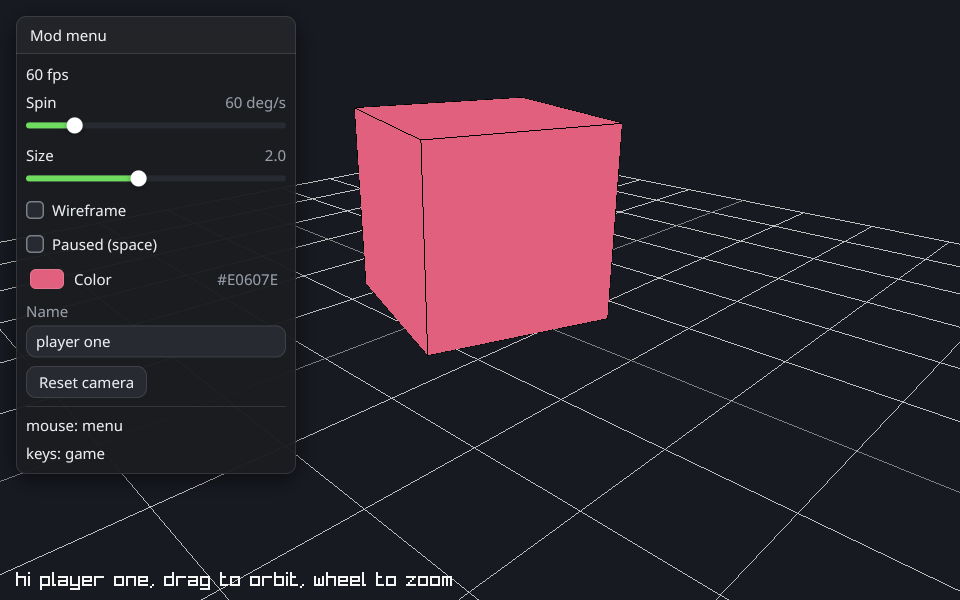

<h1 align="center">🧊 raylib 🧊</h1>

<p align="center">

</p>

<p align="center">
goome as a mod menu inside a raylib game. raylib draws a spinning cube, goome runs offscreen and gets raylib's mouse and keys pushed in, and <code>goome_gl3_render</code> puts the menu on top in raylib's own GL context.<br>
While the menu has the mouse the camera wont orbit or zoom, and while you type in the name box space wont pause the cube. That's <code>goome_ui_wants</code> doing the blocking.<br> <br>
<b>Drag</b> - orbit the camera, <b>wheel</b> - zoom, <b>space</b> - pause, <b>esc</b> - quit
</p>

<p align="center">
Ubuntu doesn't package raylib, so grab the official release next to this file:
</p>

```sh
curl -L https://github.com/raysan5/raylib/releases/download/5.5/raylib-5.5_linux_amd64.tar.gz | tar xz
cc -std=c99 -O2 -I../../vendor -I../../vendor/backends -Iraylib-5.5_linux_amd64/include main.c ../../vendor/goome.c raylib-5.5_linux_amd64/lib/libraylib.a -lm -lpthread -ldl -o raylib_demo
./raylib_demo
```

<p align="center">
If you built raylib yourself and installed it, <code>$(pkg-config --cflags --libs raylib)</code> works instead of the tarball paths.
</p>
