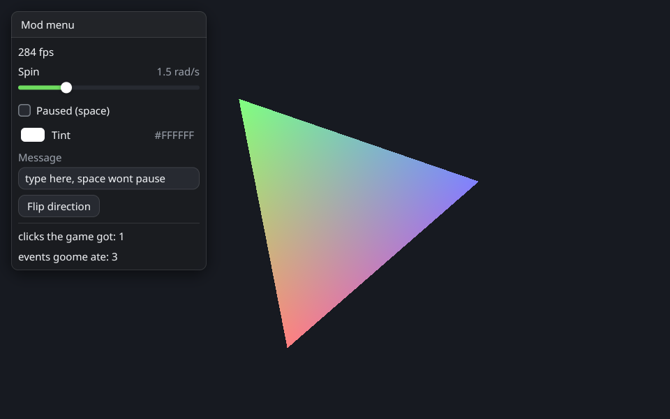

<h1 align="center">🔺 SDL2 + OpenGL 3 🔺</h1>

<p align="center">

</p>

<p align="center">
The Dear ImGui style setup: an SDL2 window, a raw OpenGL 3.3 triangle, and two goome backends. <code>goome_sdl2.h</code> turns SDL events into goome input and <code>goome_gl3.h</code> draws the menu over your frame right before <code>SDL_GL_SwapWindow</code>.<br>
Every event goes to <code>goome_sdl2_event</code> first. If it returns 1 goome used it and the game skips it, so clicking the menu wont flip the triangle and typing a space wont pause it. The menu counts what each side got.<br> <br>
<b>Click</b> - flip the spin, <b>space</b> - pause, <b>esc</b> - quit
</p>

```sh
sudo apt install libsdl2-dev
cc -std=c99 -O2 -I../../vendor -I../../vendor/backends main.c ../../vendor/goome.c $(sdl2-config --cflags --libs) -lm -o sdl_gl3
./sdl_gl3
```

<p align="center">
All GL calls go through <code>SDL_GL_GetProcAddress</code>, so there's no <code>-lGL</code> and no GL loader library to drag in.
</p>
