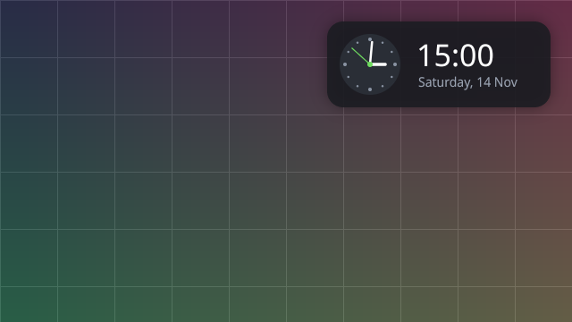

<h1 align="center">🕐 Clock 🕐</h1>

<p align="center">

</p>

<p align="center">
A clock card in the top right corner of the screen that never takes a click.
</p>

<details>
<summary align="center"><b>⌨️ How To Use ⌨️</b></summary>

<p align="center">
<b>alt+c</b> - hides it
</p>
</details>

<details>
<summary align="center"><b>🛠 Build And Run 🛠</b></summary>

```sh
pip install goome
python clock.py
```
</details>
