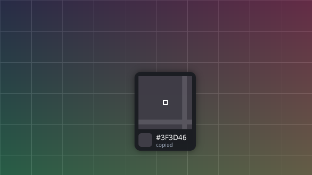

<h1 align="center">🎨 Color Picker 🎨</h1>

<p align="center">

</p>

<p align="center">
A loupe that follows the mouse and shows the hex color under it.
</p>

<details>
<summary align="center"><b>⌨️ How To Use ⌨️</b></summary>

<p align="center">
<b>alt+p</b> - copies the color
</p>
</details>

<details>
<summary align="center"><b>🛠 Build And Run 🛠</b></summary>

```sh
pip install goome
python color_picker.py
```
</details>
