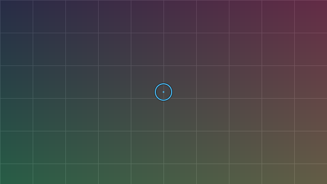

<h1 align="center">🎯 Crosshair 🎯</h1>

<p align="center">

</p>

<p align="center">
A crosshair in the middle of the screen, clicks go straight through to the game.
</p>

<details>
<summary align="center"><b>⌨️ How To Use ⌨️</b></summary>

<p align="center">
<b>alt+x</b> - next style<br>
<b>alt+up / alt+down</b> - size<br>
<b>alt+h</b> - hide
</p>
</details>

<details>
<summary align="center"><b>🛠 Build And Run 🛠</b></summary>

```sh
pip install goome
python crosshair.py
```
</details>
