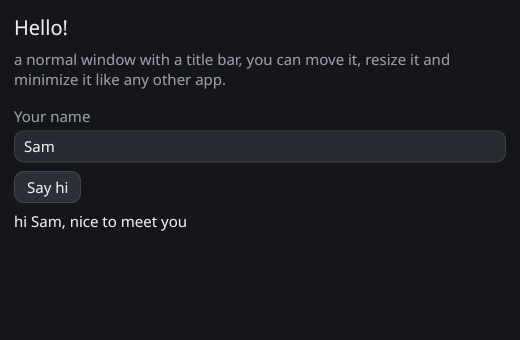

<h1 align="center">🪟 Hello App 🪟</h1>

<p align="center">

</p>

<p align="center">
A normal app window with <code>goome.App</code>. Put a function under <code>@app.frame</code> and thats the whole program.
</p>

<details>
<summary align="center"><b>🛠 Build And Run 🛠</b></summary>

```sh
pip install git+https://github.com/goome-ui/python-goome@dev
python hello_app.py
```
</details>
