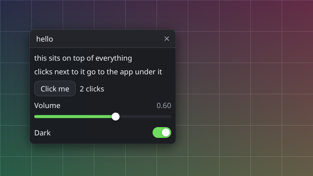

<h1 align="center">👋 Hello Overlay 👋</h1>

<p align="center">

</p>

<p align="center">
The smallest overlay in Python. A little window on top of everything, clicks next to it go to the app under it.
</p>

<details>
<summary align="center"><b>⌨️ How To Use ⌨️</b></summary>

<p align="center">
<b>the x</b> - quits
</p>
</details>

<details>
<summary align="center"><b>🛠 Build And Run 🛠</b></summary>

```sh
pip install goome
python hello_overlay.py
```
</details>
