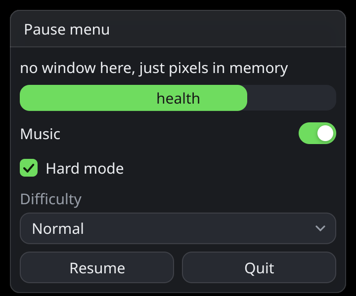

<h1 align="center">🎮 Offscreen PNG 🎮</h1>

<p align="center">

</p>

<p align="center">
No window, the ui gets drawn into memory and saved as <code>offscreen.png</code>. Only uses zlib and struct from the standard library for the PNG.
</p>

<details>
<summary align="center"><b>🛠 Build And Run 🛠</b></summary>

```sh
pip install git+https://github.com/goome-ui/python-goome@dev
python offscreen_png.py
```
</details>
