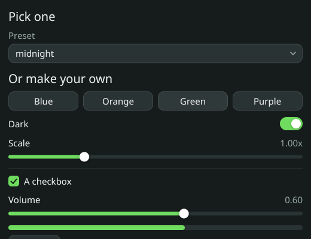

<h1 align="center">🎨 Themes 🎨</h1>

<p align="center">

</p>

<p align="center">
Theme presets, a theme made from one accent color, and scaling the whole ui, with <code>ui.theme.preset()</code>, <code>ui.theme.make()</code> and <code>ui.scale()</code>.
</p>

<details>
<summary align="center"><b>🛠 Build And Run 🛠</b></summary>

```sh
pip install goome
python themes.py
```
</details>
