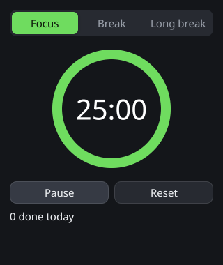

<h1 align="center">🍅 Timer 🍅</h1>

<p align="center">

</p>

<p align="center">
A pomodoro timer that stays on top, with the ring drawn on a Canvas.
</p>

<details>
<summary align="center"><b>🛠 Build And Run 🛠</b></summary>

```sh
pip install goome
python timer.py
```
</details>
