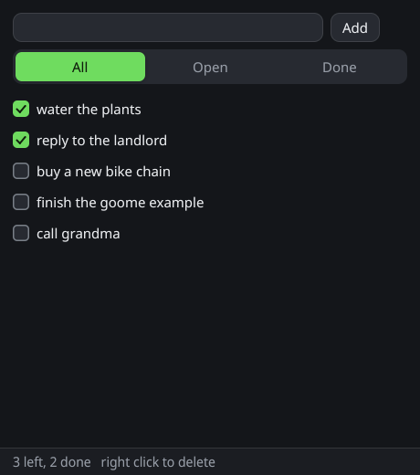

<h1 align="center">✅ Todo ✅</h1>

<p align="center">

</p>

<p align="center">
A todo list on <code>goome.App</code> that saves to <code>todo.txt</code>.
</p>

<details>
<summary align="center"><b>⌨️ How To Use ⌨️</b></summary>

<p align="center">
<b>enter</b> - adds it<br>
<b>right click</b> - delete
</p>
</details>

<details>
<summary align="center"><b>🛠 Build And Run 🛠</b></summary>

```sh
pip install goome
python todo.py
```
</details>
