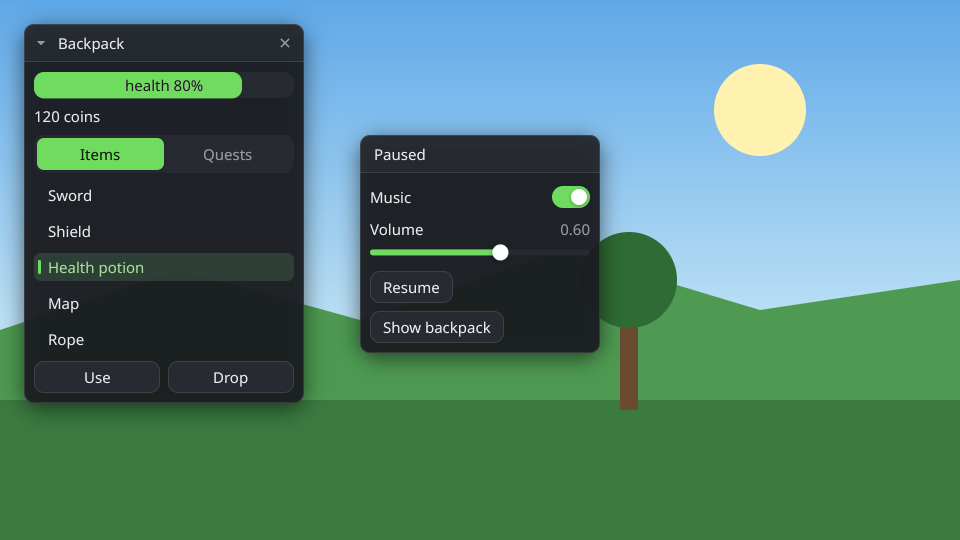

<h1 align="center">🎮 Unity Sample 🎮</h1>

A small Unity project with goome's ui inside the game, drawn offscreen into a texture, plus a desktop overlay that floats over everything from a standalone build. The picture is <code>GameHud.cs</code> rendered with the offscreen backend over a made up game scene.

<b>🛠 Set It Up 🛠</b>

 

1. Open <code>GoomeSample</code> in Unity 2021.3 or newer. <code>Packages/manifest.json</code> already pulls in the goome package from <a href="https://github.com/goome-ui/csharp-goome/tree/main/unity/com.goome-ui.goome">csharp-goome</a> 
2. In an empty scene make a UI > Raw Image, stretch it over the whole Canvas, and add the <code>GoomeView</code> and <code>HudView</code> components to it 
3. Press play. The backpack window works, clicks next to it go to your game, and the P key opens the pause menu   
For the overlay put <code>GoomeOverlay</code> and <code>DesktopBuddy</code> on any GameObject and make a standalone build. It stays off in the editor unless you tick <code>runInEditor</code> on the GoomeOverlay.

<b>📁 Whats In Here 📁</b>

 

<b>GoomeSample/Assets/Scripts/GameHud.cs</b> - the ui itself, plain GoomeSharp with nothing from Unity in it 
<b>GoomeSample/Assets/Scripts/HudView.cs</b> - hooks GameHud up to a GoomeView and gives it some game state 
<b>GoomeSample/Assets/Scripts/DesktopBuddy.cs</b> - a window on the real desktop through GoomeOverlay 
<b>check/</b> - builds the scripts against the Unity stubs from csharp-goome, so CI knows they compile without a Unity install 
<b>preview/</b> - renders GameHud offscreen for the picture up top

